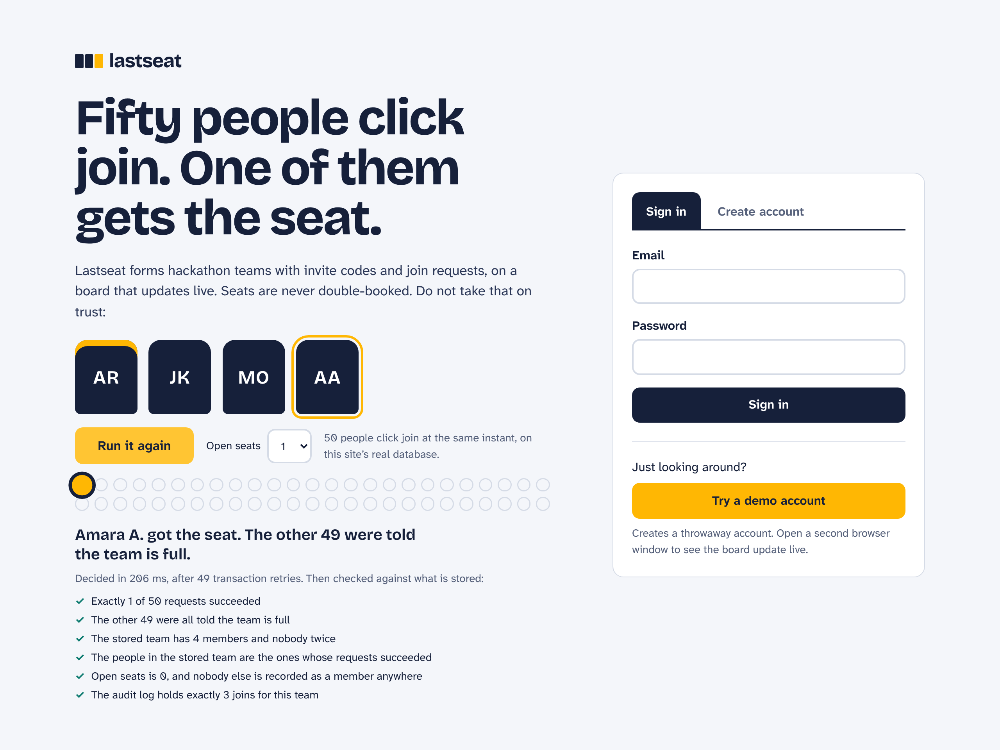
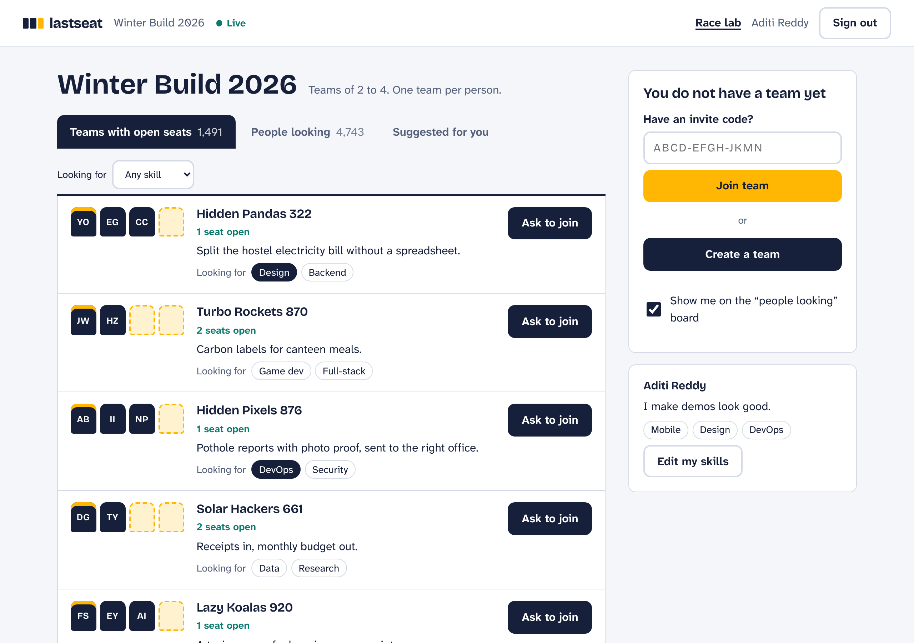
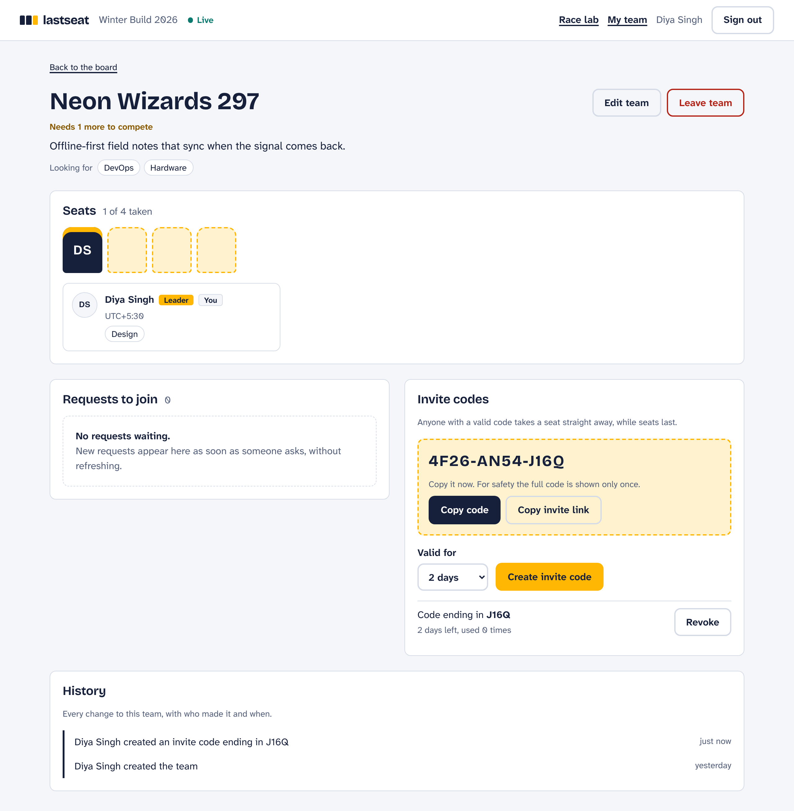
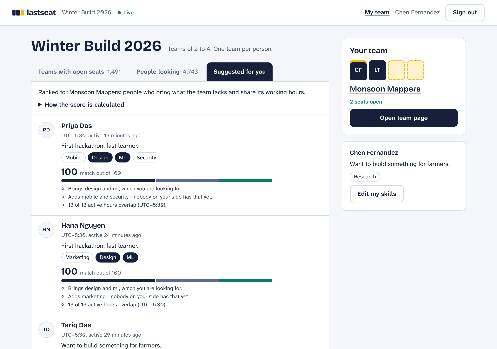
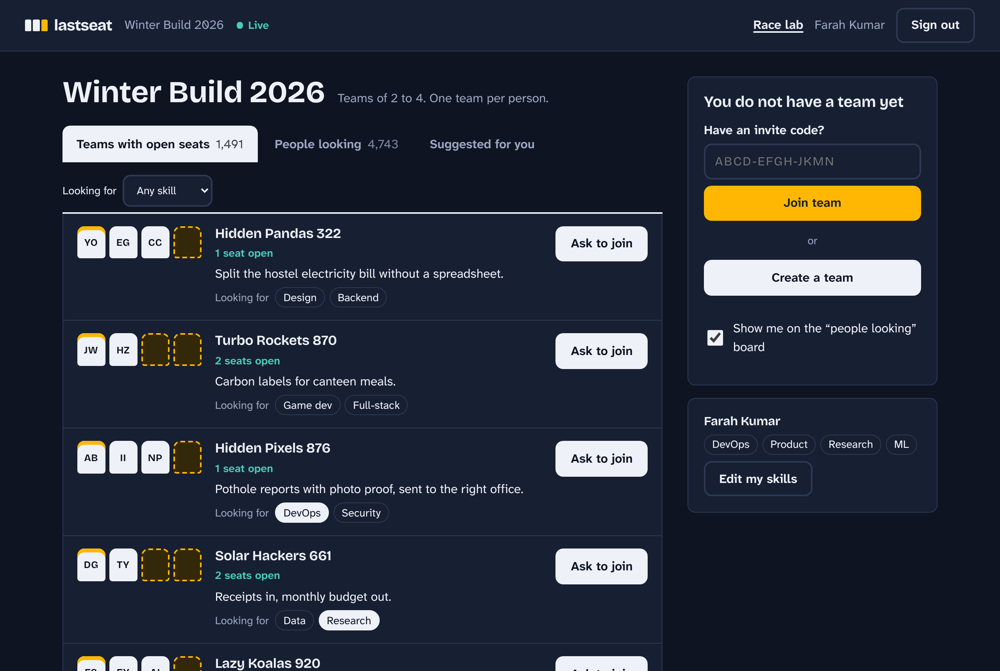
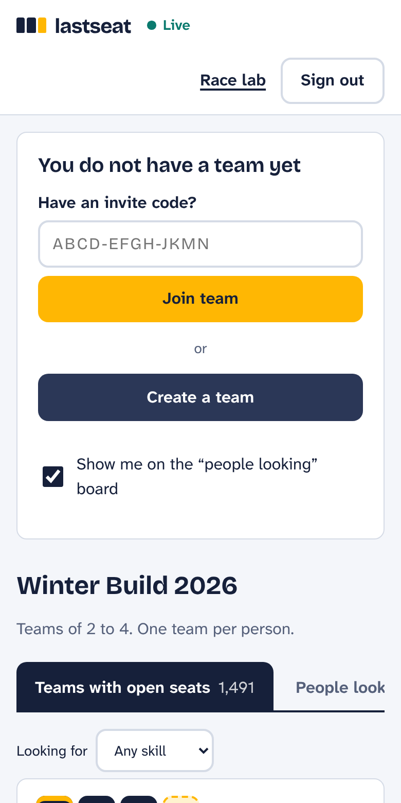

# Lastseat

Race-proof team formation for a hackathon with 10,000 participants. Fifty people can click
"join" on a team with one seat left, at the same instant, and exactly one of them gets it.

Built for the Hack4Hack Crew Hiring Challenge 2026, problem statement 1.

[](https://github.com/alphasafal/lastseat/actions/workflows/ci.yml)

- **Live demo:** https://lastseat-mu.vercel.app. Press "Run the race" on the first screen: no
  account needed. Then "Try a demo account" for the product itself.
- **Design doc (1 page):** [docs/DESIGN.md](docs/DESIGN.md), or as a [PDF](docs/DESIGN.pdf)
- **Load-test report:** [docs/LOAD_TEST_REPORT.md](docs/LOAD_TEST_REPORT.md)

Stack: React 19 + Vite, Node.js 22 + Express 5, MongoDB 8 (official driver). No Redis, no
message broker, no ORM.

## Try the claim yourself

The landing page has a button, **Run the race**. It makes the server create a throwaway team
with one seat left and 50 throwaway people, lets all 50 join in the same instant through the
same code path a normal join uses, and shows what the database decided: who got the seat, that
the other 49 were told the team is full, how long it took, and six checks read back from the
stored data. Nothing is simulated, and everything the run created is deleted afterwards.
(`POST /api/lab/race`, [`server/src/lab/routes.js`](server/src/lab/routes.js).)





| Team page as the leader                 | Suggested teammates, with the score explained    |
| --------------------------------------- | ------------------------------------------------ |
|  |  |

| Dark theme (follows the system setting)        | On a phone                                  |
| ---------------------------------------------- | ------------------------------------------- |
|  |  |

## Run it

One command, with Docker:

```bash
docker compose up --build
```

This starts MongoDB as a one-node replica set, seeds 10,000 users and 2,000 teams, and
serves the app at <http://localhost:4000>.

Without Docker you need Node 22 and a MongoDB 6+ started with `--replSet rs0`
(transactions and change streams need a replica set; one node is enough):

```bash
npm install
npm run db:init -w server   # once: turns the fresh mongod into a one-node replica set
npm run seed                # 10,000 users, 2,000 teams, about two seconds
npm run build && npm start  # http://localhost:4000
# or, for development with hot reload:  npm run dev   (web on :5173, API on :4000)
```

Sign in with "Try a demo account", or as any seeded user: `user00001@seed.lastseat.test` to
`user10000@seed.lastseat.test`, password `hackathon-demo`. Open a second browser window as
someone else to watch the board and team pages update live.

## How the last seat stays single

The whole answer is one MongoDB operation in
[`server/src/teams/service.js`](server/src/teams/service.js):

```js
teams.findOneAndUpdate(
  { _id: teamId, openSeats: { $gt: 0 }, 'members.userId': { $ne: userId } },
  { $push: { members: member }, $inc: { memberCount: 1, openSeats: -1, version: 1 } },
);
```

The check ("is there a seat? am I already in?") is part of the write, so there is no moment
between reading and writing for another request to slip into. A unique index on
`(hackathonId, members.userId)` makes it impossible for one person to be in two teams. The
claim runs in a transaction together with its audit entry, the board row and the
idempotency record, so a join is either completely there or not there at all.

To see the bug this avoids, run `node server/scripts/race-demo.js`: a read-then-write version
lets all 50 people into the last seat in every round; the conditional update lets in one.

[docs/DESIGN.md](docs/DESIGN.md) covers the data model, the other races and the trade-offs.

## Requirements and where each one lives

| Requirement                                  | Implementation                                                                                       | Proof                                            |
| -------------------------------------------- | ---------------------------------------------------------------------------------------------------- | ------------------------------------------------ |
| Team size between min and max                | `openSeats` guard in the claim; status `forming` / `ready` / `full`                                  | `teams.test.js` "status follows the size rules"  |
| One team per person per hackathon            | unique multikey index `uniq_member_per_hackathon` ([`db.js`](server/src/db.js))                      | `race.test.js` "one person joining two teams"    |
| Invite codes that expire                     | `invites` collection, expiry compared on the server clock, revocable                                 | `invites.test.js`                                |
| Leadership passes on when the leader leaves  | `detachMember` in `service.js` (longest-standing member)                                             | `teams.test.js`                                  |
| Last member leaving deletes the team         | `detachMember`, also closes invites and requests                                                     | `teams.test.js`, `race.test.js`                  |
| Join requests the leader accepts or declines | `join_requests`, same atomic claim on accept                                                         | `requests.test.js`                               |
| Race-proof: 50 people, one seat, one winner  | conditional update + unique index + transaction                                                      | `race.test.js` (9 tests), live race lab          |
| Idempotent retries                           | `Idempotency-Key` stored in the same transaction ([`idempotency.js`](server/src/lib/idempotency.js)) | `idempotency.test.js`                            |
| Real-time board and team pages               | SSE fed by a change stream on the audit log ([`realtime/`](server/src/realtime))                     | `realtime.test.js`, `e2e/flow.mjs`               |
| Authentication                               | scrypt passwords, hashed session tokens, httpOnly SameSite cookie, Origin check                      | `auth.test.js`                                   |
| Only the leader can accept, decline, remove  | leader id is part of the write filter                                                                | `teams.test.js`, `requests.test.js`              |
| Invite codes cannot be brute-forced          | 60 bits of entropy, stored as SHA-256, 10 attempts per 10 min per user                               | `invites.test.js`                                |
| Every input validated                        | strict zod schemas for bodies, queries and ids ([`validate.js`](server/src/lib/validate.js))         | `teams.test.js` "ids, bodies and unknown fields" |
| Audit log: who, what, when                   | `audit_log`, written in the same transaction as the change                                           | `audit.test.js`                                  |
| Teammate suggestions with explained scoring  | pure functions in [`board/score.js`](server/src/board/score.js)                                      | `suggestions.test.js`                            |
| At least 20 API tests in CI                  | 95 tests, GitHub Actions                                                                             | [`ci.yml`](.github/workflows/ci.yml)             |
| Seed 10,000 users and 2,000 teams            | [`scripts/seed.js`](server/scripts/seed.js)                                                          | `npm run seed`                                   |
| Load test, p95 under 200 ms at 100 users     | k6, [`loadtest/board.js`](loadtest/board.js)                                                         | [report](docs/LOAD_TEST_REPORT.md)               |
| React UI, phone and keyboard only            | [`web/`](web/src)                                                                                    | `e2e/flow.mjs`                                   |
| Deployed on a free tier                      | Vercel + MongoDB Atlas ([`vercel.json`](vercel.json), [`api/index.js`](api/index.js))                | live demo link above                             |

Bonus items: optimistic UI with rollback on conflict (`web/src/pages/Team.jsx`, checked in
`e2e/flow.mjs`), Docker Compose, Prometheus metrics at `/metrics`, and a chaos test that kills
the server in the middle of a join (`server/test/chaos.test.js`). Beyond the brief: the public
race lab, and a dark theme that follows the system setting.

## Tests

```bash
npm test             # 95 tests against a real MongoDB, about 45 s
npm run test:race    # only the concurrency tests
npm run test:chaos   # SIGKILL the server mid-join, check nothing is corrupted
npm run verify       # check every data invariant against the current database
npm run e2e          # browser flow in headless Chrome (needs `npm start` running)
```

Nothing is mocked. Each test file starts the real server on a random port with its own
database and talks to it over HTTP. `npm run verify` runs the same invariant checker the
race and chaos tests use: member counts, seat counts, one team per person, board rows and an
audit log that adds up to the current membership.

CI ([`ci.yml`](.github/workflows/ci.yml)) runs all of it on every push: lint, the 95 API tests
including the race and chaos tests, then the browser flow against a running server. A second
job starts the stack from scratch with `docker compose up --build`, runs the 50-way race on
it and checks every invariant on the seeded data.

## Load test

```bash
npm run seed
RATE_AUTH_PER_IP=100000 NODE_ENV=production npm start   # all virtual users share one IP
k6 run loadtest/board.js                   # 100 readers + 10 writers, 2 minutes
k6 run -e MODE=saturate loadtest/board.js  # no think time
node loadtest/live-latency.js              # 300 SSE streams, commit-to-client latency
```

Results and method are in [docs/LOAD_TEST_REPORT.md](docs/LOAD_TEST_REPORT.md).

## API

All routes are under `/api`, use JSON and require the session cookie, except `/auth/*`.
Errors have the shape `{ "error": { "code": "TEAM_FULL", "message": "..." } }`; clients switch
on `code`. Writes accept an `Idempotency-Key` header.

| Method and path                                                       | What it does                                      |
| --------------------------------------------------------------------- | ------------------------------------------------- |
| `POST /auth/register`, `/auth/login`, `/auth/demo`, `/auth/logout`    | account and session                               |
| `GET /auth/session`, `GET /auth/me`                                   | who am I                                          |
| `GET /hackathons`, `GET /hackathons/:id`                              | size rules and board totals                       |
| `POST /hackathons/:id/participants`                                   | register for the hackathon (idempotent)           |
| `GET, PATCH /hackathons/:id/me`                                       | my skills, headline, time zone, "looking" flag    |
| `GET /hackathons/:id/board/teams`, `/board/people`                    | the board; `?skill=`, `?cursor=`, `?limit=`       |
| `GET /hackathons/:id/suggestions`                                     | ranked teammates with a score breakdown           |
| `POST /hackathons/:id/teams`                                          | create a team                                     |
| `GET, PATCH /teams/:id`                                               | read; leader edits                                |
| `POST /teams/:id/leave`                                               | leave (passes leadership on, or deletes the team) |
| `DELETE /teams/:id/members/:userId`                                   | leader removes a member                           |
| `PUT /teams/:id/leader`                                               | leader hands over leadership                      |
| `GET, POST /teams/:id/invites`, `DELETE /teams/:id/invites/:inviteId` | invite codes (leader)                             |
| `POST /invites/join`                                                  | take a seat with a code                           |
| `POST /lab/race`                                                      | public: stage a 50-way race, report the outcome   |
| `POST /teams/:id/requests`, `GET /teams/:id/requests`                 | ask to join; leader's inbox                       |
| `POST /requests/:id/accept`, `/decline`, `/cancel`                    | decide or withdraw a request                      |
| `GET /teams/:id/audit`, `GET /hackathons/:id/audit`                   | history (members; organizers)                     |
| `GET /stream?hackathonId=&teamId=`                                    | server-sent events                                |
| `GET /healthz`, `GET /metrics`                                        | health and Prometheus metrics (outside `/api`)    |

## Deploy (free tier)

The live demo runs on Vercel (Hobby) with a MongoDB Atlas free cluster.

1. Create a free MongoDB Atlas cluster, allow access from anywhere, copy the connection string.
2. Import this repository in Vercel. [`vercel.json`](vercel.json) holds the build and routing.
3. Set the environment variables below and deploy. The build seeds the database (10,000 users,
   2,000 teams) the first time and skips it afterwards.

| Variable                   | Value                                                                              |
| -------------------------- | ---------------------------------------------------------------------------------- |
| `MONGODB_URI`              | the Atlas connection string, with `/lastseat` as the database name                 |
| `TRUST_PROXY`              | `1`, so rate limits see the visitor's address                                      |
| `MONGO_MAX_POOL`           | `10`, because serverless instances multiply                                        |
| `SSE_MAX_STREAM_MS`        | `280000`, to end event streams just before the 300 s request limit                 |
| `SSE_IDLE_PAUSE_MS`        | `600000`: a page lets go of its stream after 10 minutes without input (see below)  |
| `TXN_DEADLINE_MS`          | `25000`, because a free Atlas cluster is limited to 100 operations a second        |
| `LAB_NOTE`                 | optional: a sentence shown under race results (the demo explains that limit)       |
| `RECONNECT_AFTER_PAUSE_MS` | `15000`, because Vercel freezes idle instances and their database sockets go stale |

On Vercel the React app is served as static files and the whole API is one function
([`api/index.js`](api/index.js)) on the same origin, so cookies are first-party and there is no
CORS configuration. An instance stays alive while it has an event stream open and tails its
own change stream, so live updates work without any extra service. An idle instance is
frozen rather than stopped, which leaves it holding dead database sockets when it wakes;
[`suspension.js`](server/src/suspension.js) notices the gap and reconnects before the first
request is served.

Vercel bills an instance's memory for as long as it has a request in flight, and an open
event stream is one. A forgotten browser tab would therefore keep an instance running around
the clock and use up the free allowance in about a week. So a stream is only held while it is
useful ([`web/src/lib/live.js`](web/src/lib/live.js)): a hidden tab closes it after 20 s,
and with `SSE_IDLE_PAUSE_MS` set, so does a page nobody has touched for that long. The
indicator then reads "Paused"; coming back to the page opens a new stream and refetches, so
nothing is missed. On a long-running server the setting is off and only hidden tabs pause.

The same code runs as one long-lived process anywhere Node runs: `npm run build && npm start`
serves the UI and the API from Express. [`render.yaml`](render.yaml) and the
[`Dockerfile`](Dockerfile) are ready for that.

## Layout

```
server/src/teams/service.js   every state change: claim, leave, invites, requests
server/src/db.js              indexes (the invariants) and the transaction helper
server/src/lib/               idempotency, audit, validation, rate limits, invariant checker
server/src/realtime/          change stream -> hub -> SSE
server/src/board/             board queries, page cache, suggestion scoring
server/src/lab/               the public race lab
server/src/suspension.js      reconnects after a serverless host froze the process
api/index.js                  serverless entry (Vercel); server/src/index.js is the long-running one
server/test/                  API, race and chaos tests
web/src/                      React app
loadtest/                     k6 script, SSE latency probe, rate-limit proxy, results
e2e/flow.mjs                  browser flow: race lab, live updates, keyboard only, rollback,
                              remove, invite link, hidden tab
```

## Known limits

Stated plainly, because they are the first things I would fix:

- If a server process is killed in the middle of a transaction, MongoDB keeps that one team
  write-locked until its transaction timeout (60 s by default). Other teams are unaffected and
  nothing is corrupted; requests for that team get a retryable `503 BUSY` meanwhile.
- A client that reconnects to the stream refetches its page instead of replaying missed events.
  The same happens when a paused page (hidden tab, or 10 minutes without input on the demo)
  resumes. On Vercel a stream is ended every 280 s (the platform caps requests at 300 s), so this
  happens routinely there; the page stays correct and the indicator does not flicker.
- The per-request API rate limit is in memory, so it is per server instance. The limits that
  protect logins and invite codes are stored in MongoDB and hold across instances.
- The hosted demo's database is a free cluster limited to 100 operations a second. The
  50-way race takes 4 to 5 s there and about 0.3 s without the limit; the outcome is the same.
  Section 5 of the [load-test report](docs/LOAD_TEST_REPORT.md) has the measurements.
- A person's name cannot be changed after sign-up.
